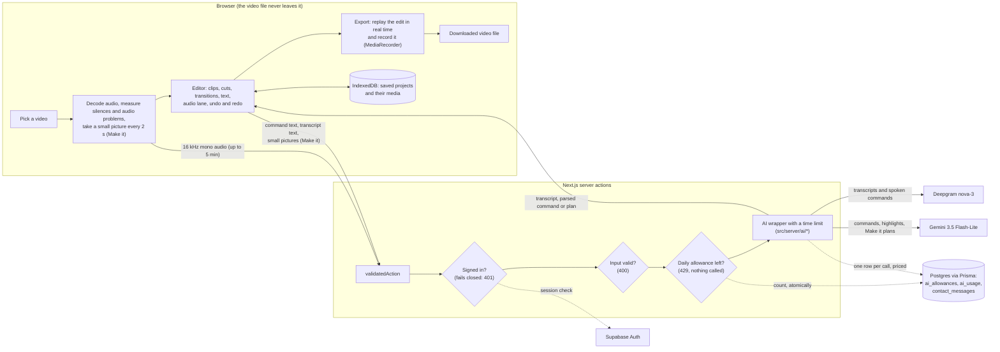

# Architecture

How Retake is built, why, and where it falls short. Everything here
describes `main` as it is; each decision names the file that shows it.

## How a video moves through the app

The file itself is played from an object URL, edited, exported and saved in
the browser. Only three things leave it: the decoded audio (for a
transcript, to Deepgram), text (typed and spoken commands, the transcript's
sentences, to Gemini) and, for Make it, the transcript plus one small
picture every 2 seconds (to Gemini).

## Module map

The editor (`src/app/[locale]/editor/`) is grouped by concern. At its root
are only the route (`page.tsx`, `layout.tsx`), its server actions
(`actions.ts`) and `video-editor.tsx`, the component that wires the rest
together. Each test sits next to the file it tests.

| Folder        | What's in it                                                                                                                                                                             |
| ------------- | ---------------------------------------------------------------------------------------------------------------------------------------------------------------------------------------- |
| `model/`      | The edit itself, as plain TypeScript: clips and their order, cuts, speed, transitions, picture transforms, color, the audio lane, added videos, undo history.                            |
| `overlays/`   | What's drawn over the picture: titles, lower thirds, captions, logos, annotations, motion, designed frames, text styles.                                                                 |
| `audio/`      | Reading the recording: the transcript, silences and audio problems, filler cuts, and re-recording a sentence.                                                                            |
| `assistant/`  | Typed and spoken commands and highlights: the shapes Gemini must reply in, and the plans they become.                                                                                    |
| `export/`     | Turning the edit into a video file.                                                                                                                                                      |
| `projects/`   | Saving and opening projects, and the hand-off from Home or Make it into the editor.                                                                                                      |
| `components/` | The interface, by area: `shell/` (top bar, tool rail, save state), `preview/` (the player and what is dragged on it), `timeline/`, `panels/` (the tool panels), `assistant/` (the chat). |

The files a reviewer is most likely to want:

| Module                                                 | What it does                                                                                                                                                                                                                                                                    |
| ------------------------------------------------------ | ------------------------------------------------------------------------------------------------------------------------------------------------------------------------------------------------------------------------------------------------------------------------------- |
| `src/app/[locale]/editor/model/sequence.ts`            | The edit as an ordered sequence of clips, each one or more ranges of a source file. Split, reorder, merge, delete and duplicate only rearrange it; trim and cuts decide what's removed. What plays is tracked by segment, never inferred from a time.                           |
| `src/app/[locale]/editor/model/transitions.ts`         | Fades through black (the edit keeps its length), and dissolves and slides (the clips overlap, the edit gets shorter), stored on the join into a clip so moving or deleting a clip drops them with no bookkeeping.                                                               |
| `src/app/[locale]/editor/model/transform.ts`           | Flip, rotate to any angle, then crop, as one matrix from the source picture to the output frame. The preview and the export both use it, so they match.                                                                                                                         |
| `src/app/[locale]/editor/model/audio-lane.ts`          | Sounds of their own on the edited timeline: added files (music, a voice-over) or a clip's own sound taken out of it, moved, trimmed and mixed over the video.                                                                                                                   |
| `src/app/[locale]/editor/assistant/edit-command.ts`    | The shape a typed or spoken command must have (`editCommandSchema`, checked on every reply, and `EDIT_COMMAND_JSON_SCHEMA`, the shape Gemini is asked for) and `commandToPlan`, which turns a parsed command into a plan for the user to confirm, or a refusal with the reason. |
| `src/app/[locale]/editor/export/export-video.ts`       | Real-time export: an offscreen copy of each video plays the kept segments in order while a `MediaRecorder` records a canvas (30 fps) and the Web Audio mix. Stops cleanly if the tab is hidden.                                                                                 |
| `src/app/[locale]/editor/projects/projects.ts`         | Saved projects in IndexedDB: the edit, the transcript, and each media file once. A save is one transaction, done only when it commits; re-linking a missing file checks a fingerprint of its ends.                                                                              |
| `src/server/ai/google.ts`, `src/server/ai/deepgram.ts` | The only places an AI SDK or API is called. Each call has a time limit and goes through `trackAiCall`, which writes one priced row to `ai_usage`.                                                                                                                               |
| `src/server/actions/validated-action.ts`               | Every server action's wrapper: the sign-in check (`signedIn`), input validation (Zod), the daily allowance (`allowance`), and errors turned into a plain `{ ok: false, error, status }`.                                                                                        |
| `src/lib/ai-limits.ts`                                 | `DAILY_AI_LIMITS`: each user's daily number per kind of AI action. The one place to change them; the Pricing page reads them too.                                                                                                                                               |
| `src/app/[locale]/(app)/make/make-plan.ts`             | Make it's planner: turns Gemini's reply (which sentences to keep, captions, shape, text) into a concrete edit the editor applies as one undo step, checked against what was actually said.                                                                                      |

## Key decisions

### Gemini for parsing commands

"Cut from 2 to 5 seconds" becomes `{ action, startSeconds, endSeconds }`
through Gemini 3.5 Flash-Lite with a JSON schema at temperature 0: a small
structured task where the cheapest, fastest model is enough. A reply that
doesn't fit the schema comes back as "unsupported", and every parsed command
is shown as a plan the user confirms before anything changes.
_Trade-off:_ a network round trip and a small cost per command, and
wording the schema doesn't cover is refused rather than guessed.
Proof: `src/app/[locale]/editor/actions.ts` (`parseEditCommand`),
`assistant/edit-command.ts`.

### Deepgram for the transcript

Gemini's word timestamps drifted too much to cut filler words by. An early
measurement of how far off they were was later found invalid (its ground
truth was not reliable), so no figure is given here. Deepgram's `nova-3`
with `filler_words=true` reports "um" and "uh" as timed words. Even so, on
an exact-timing benchmark it was 25–105 ms off, against fillers lasting
170–315 ms, so its times are never cut at directly (next decision).
_Trade-off:_ a second provider and key. Proof: `src/server/ai/deepgram.ts`,
`src/app/[locale]/editor/audio/use-take-analysis.ts`.

### Gap detection for filler cuts

A filler is cut only where a measurable quiet gap (at least 40 ms, below a
threshold set from the recording's own noise floor) sits on both sides of
it, and the cut never leaves those gaps. A filler that runs straight into a
word has no such gap and is left for review, where the user sets the cut by
ear. Silences come from measured loudness, not from any model.
_Trade-off:_ some fillers stay in; speech is never clipped.
Proof: `src/app/[locale]/editor/audio/filler-cuts.ts`, `audio-gaps.ts`.

### Export in the browser

The export replays the edit and records it, rather than using ffmpeg.wasm
(about a 30 MB download) or encoding on a server (uploading the whole
video). There's no dependency and the footage never leaves the browser.
_Trade-off:_ it takes as long as the edit runs, the tab must stay in front
(hiding it stops the export with a message and offers no file), and under
heavy memory pressure a file can come out a little long or short, which
the app measures and says.
Proof: `src/app/[locale]/editor/export/export-video.ts`, `export-button.tsx`.

### Projects in IndexedDB

Saved projects (the edit, the transcript and the media) are kept in the
browser, so videos are never uploaded and nothing is stored on a server.
_Trade-off:_ a project lives in one browser on one machine, and how many
fit depends on that browser's storage; a full store says so plainly.
Proof: `src/app/[locale]/editor/projects/projects.ts`.

### Local Supabase

Supabase runs in Docker for sign-in only (Postgres and Auth; the Data API,
Studio, storage, realtime, edge functions and analytics are off). Prisma
owns all application data, and every table has row level security on with
no policies, so no other database role can read a row.
_Trade-off:_ nothing hosted to set up, but a deployment needs a real
Supabase project and its settings.
Proof: `supabase/config.toml`, `src/server/auth/session.ts`,
`scripts/check-rls.mjs`.

### One chokepoint for AI calls, with cost tracking

Feature code calls `src/server/ai/<provider>`; ESLint fails the build on any
other import of an AI SDK. Each call writes one row to `ai_usage`, priced at
the time of the call (an unknown price is stored as null, never zero). A
failed write costs the row, never the call.
_Trade-off:_ every new model or provider must be registered before it can
be called. `ai_usage` is read by another system (MOAD), so its columns are
not changed casually.
Proof: `src/server/ai/google.ts`, `src/server/lib/ai-usage/sink.ts`,
`src/server/lib/ai-usage/models.ts`, `eslint.config.mjs`.

### 5-minute caps

Transcripts, Make it and highlights work on videos up to 5 minutes. That
bounds what one request can send (about 12.8 MB of audio, or up to 150
small pictures) and what one call can cost.
_Trade-off:_ longer videos are refused for those features, with a plain
message. Proof: `src/app/[locale]/editor/audio/take-audio.ts`
(`MAX_TRANSCRIBE_SECONDS`), `src/app/[locale]/(app)/make/make-plan.ts`
(`MAX_MAKE_SECONDS`).

### Fail-closed sign-in on every paid action

The sign-in redirect in `src/proxy.ts` lets a request through when Supabase
can't be reached, so each of the seven paid actions checks the session
itself and refuses with a 401 when it can't confirm it. A production server
won't start without the Supabase settings (it logs which to set and exits).
Every provider call has a time limit (30 or 60 s).
_Trade-off:_ if Supabase is down, the AI features are down too.
Proof: `src/server/auth/session.ts` (`requireUser`),
`src/server/actions/validated-action.ts`, `src/lib/production-settings.ts`,
`instrumentation.ts`.

### Daily limits in their own table

Each signed-in user has a daily allowance per kind of AI action (typed
commands 300, spoken commands 200, transcripts 30, highlight searches 30,
Make it 60), counted per UTC day in `ai_allowances`. Taking one is a single
conditional update, so simultaneous requests can't go past the ceiling. A
call whose provider fails or times out is given back. `ai_usage` is left
alone because another system reads it.
_Trade-off:_ a ceiling, not a budget: at these numbers one account could
still spend about $4.58 a day at the highest cost seen per call.
Proof: `src/lib/ai-limits.ts`, `src/server/lib/ai-allowance.ts`,
`prisma/schema/ai-allowance.prisma`.

### A limit on the contact form

The public contact form has a hidden honeypot field and a per-sender limit
counted from the saved messages: 5 an hour per sender, 30 an hour shared by
senders who can't be told apart. A sender is stored only as an HMAC of
their IP with `CONTACT_IP_SECRET`, never the IP. Both checks refuse with
the same plain message.
_Trade-off:_ the IP is read from the last `x-forwarded-for` entry, which is
trustworthy behind a host that sets it (Vercel) but could be set by a
client on a server with no proxy in front.
Proof: `src/app/[locale]/(site)/contact/actions.ts`, `contact-limit.ts`.

## Known limits

- **Email confirmation is off** (`supabase/config.toml`), so accounts cost
  nothing to create; the daily limits cap each one, not how many there are.
- **Request size.** Transcription sends up to about 12.8 MB and Make it up
  to about 9 MB in one request (the server-action body limit is raised to
  about 13.8 MB in `next.config.ts`). Many hosts cap request bodies lower
  ([Vercel's is 4.5 MB](https://vercel.com/docs/functions/limitations), on
  every plan), so these may fail there.
- **Export runs in real time in the browser**, as long as the edit, with
  the tab in front.
- **Projects are per-browser**: they don't follow a user to another browser
  or device.
- **Large files**: the `VideoEditor` component is about 2,550 lines
  (`src/app/[locale]/editor/video-editor.tsx`) and `planMake` about 510
  (`make-plan.ts`).
- **Unused template scaffolding**: the admin roles, feature flags and their
  admin action (about 1,340 lines in `src/lib/rbac`, `src/lib/flags`,
  `src/server/actions/feature-flags.ts`) aren't used by the product.
- **CI doesn't exercise real sign-in**: it runs with accounts off, and the
  sign-in checks are covered by unit tests with the session mocked.

## Deployment notes

- **Settings a production server needs to start:** `DATABASE_URL`,
  `NEXT_PUBLIC_SUPABASE_URL`, `NEXT_PUBLIC_SUPABASE_PUBLISHABLE_KEY` and
  `CONTACT_IP_SECRET` (at least 32 characters; `openssl rand -hex 32`).
  Without one, the server logs which is missing and exits.
- **For the AI features:** `GEMINI_API_KEY` and `DEEPGRAM_API_KEY`. The
  server starts without them, and those features then fail with a
  generic error.
- **Migrations:** CI writes them from the Prisma schema, and
  `.github/workflows/deploy-migrations.yml` applies them to production on
  every push to `main`.
- **Client IP:** the contact limit trusts the last `x-forwarded-for`
  entry, so deploy behind a host or proxy that sets it.

## What I'd do next

1. Move transcription uploads off the request body (compressed audio, or
   an upload to storage passed by reference), so they fit any host's limit.
2. Turn on email confirmation, so the daily limits apply to real people.
3. Split the `VideoEditor` component into hooks by concern (project
   save/open, export flow, command dispatch) when those parts are next
   changed, and `planMake` into its stages.
4. Remove the unused admin and feature-flag scaffolding, or document it as
   kept on purpose.
5. Run e2e against a real local Supabase in CI, so sign-in is exercised
   there.
6. Offer a way to move a project between browsers (an export and import of
   the saved project).
