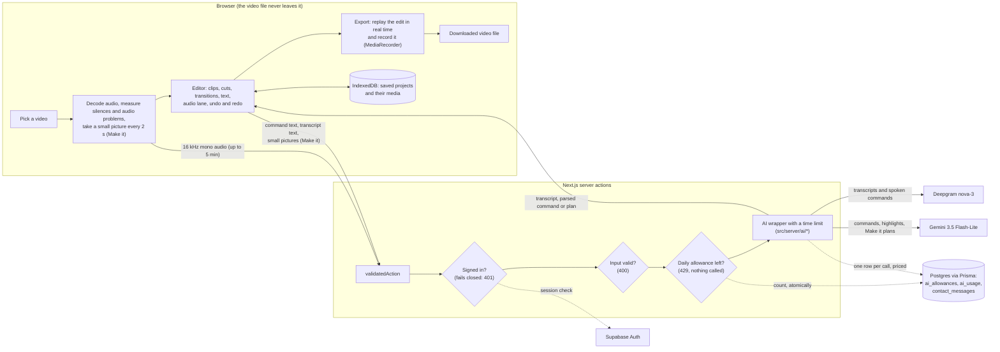

# Architecture

How Retake is built, why, and where it falls short. Everything here
describes `main` as it is; each decision names the file that shows it.

## How a video moves through the app

The file itself is played from an object URL, edited, exported and saved in
the browser. Of the video and what's said in it, only four things leave
it: the decoded audio (for a transcript, to Deepgram), the microphone
recording of a spoken command (to Deepgram), text (typed commands, spoken
commands once transcribed, the transcript's sentences, to Gemini) and, for
Make it, the transcript plus one small picture every 2 seconds (to Gemini).
Once their keys are set, PostHog also receives the typed events and page
views (ids, enums and booleans, never the video or what's said) and Sentry
receives error reports; with no key set, neither sends anything.

## Module map

The editor (`src/app/[locale]/editor/`) is grouped by concern. At its root
are only the route (`page.tsx`, `layout.tsx`), its server actions
(`actions.ts`), `video-editor.tsx`, the component that wires the rest
together, and `video-editor-helpers.ts`, its constants and small helpers. Each test sits next to the file it tests.

| Folder        | What's in it                                                                                                                                                                                                                                                                                                                                                                                                                                                   |
| ------------- | -------------------------------------------------------------------------------------------------------------------------------------------------------------------------------------------------------------------------------------------------------------------------------------------------------------------------------------------------------------------------------------------------------------------------------------------------------------- |
| `model/`      | The edit itself, as plain TypeScript: clips and their order, cuts, speed, transitions, picture transforms, color, the audio lane, added videos, undo history.                                                                                                                                                                                                                                                                                                  |
| `overlays/`   | What's drawn over the picture: titles, lower thirds, captions, logos, annotations, motion, designed frames, text styles.                                                                                                                                                                                                                                                                                                                                       |
| `audio/`      | Reading the recording: the transcript, silences and audio problems, filler cuts, and re-recording a sentence (`useReRecord` for its state, `useReRecordActions` for opening, previewing, applying and closing it).                                                                                                                                                                                                                                             |
| `assistant/`  | Typed and spoken commands and highlights: the shapes Gemini must reply in, and the plans they become.                                                                                                                                                                                                                                                                                                                                                          |
| `export/`     | Turning the edit into a video file.                                                                                                                                                                                                                                                                                                                                                                                                                            |
| `projects/`   | Saving and opening projects, and the hand-off from Home or Make it into the editor; `useProjectFile`: the editor's save, open, relink, delete and autosave.                                                                                                                                                                                                                                                                                                    |
| `components/` | The interface, by area: `shell/` (top bar, tool rail, save state, `useEditorShortcuts`: undo and redo from the keyboard, and `useEditorTools`: the rail's tools, each one's icon and panel), `preview/` (the player, what is dragged on it, the buttons on the bar over the video, and `usePickedItem`: what's picked on the video and the Text lane's items), `timeline/`, `panels/` (the tool panels, the Videos panel among them), `assistant/` (the chat). |

The files a reviewer is most likely to want:

| Module                                                 | What it does                                                                                                                                                                                                                                                                                                                                                                                                                                                                                                                                                                                                                                                                                                                                                                                                                                                                                                                                     |
| ------------------------------------------------------ | ------------------------------------------------------------------------------------------------------------------------------------------------------------------------------------------------------------------------------------------------------------------------------------------------------------------------------------------------------------------------------------------------------------------------------------------------------------------------------------------------------------------------------------------------------------------------------------------------------------------------------------------------------------------------------------------------------------------------------------------------------------------------------------------------------------------------------------------------------------------------------------------------------------------------------------------------ |
| `src/app/[locale]/editor/model/sequence.ts`            | The edit as an ordered sequence of clips, each one or more ranges of a source file. Split, reorder, merge, delete and duplicate only rearrange it; trim and cuts decide what's removed. What plays is tracked by segment, never inferred from a time.                                                                                                                                                                                                                                                                                                                                                                                                                                                                                                                                                                                                                                                                                            |
| `src/app/[locale]/editor/model/transitions.ts`         | Fades through black (the edit keeps its length), and dissolves and slides (the clips overlap, the edit gets shorter), stored on the join into a clip so moving or deleting a clip drops them with no bookkeeping.                                                                                                                                                                                                                                                                                                                                                                                                                                                                                                                                                                                                                                                                                                                                |
| `src/app/[locale]/editor/model/transform.ts`           | Flip, rotate to any angle, then crop, as one matrix from the source picture to the output frame. The preview and the export both use it, so they match.                                                                                                                                                                                                                                                                                                                                                                                                                                                                                                                                                                                                                                                                                                                                                                                          |
| `src/app/[locale]/editor/model/audio-lane.ts`          | Sounds of their own on the edited timeline: added files (music, a voice-over) or a clip's own sound taken out of it, moved, trimmed and mixed over the video.                                                                                                                                                                                                                                                                                                                                                                                                                                                                                                                                                                                                                                                                                                                                                                                    |
| `src/app/[locale]/editor/assistant/edit-command.ts`    | The shape a typed or spoken command must have (`editCommandSchema`, checked on every reply, and `EDIT_COMMAND_JSON_SCHEMA`, the shape Gemini is asked for) and `commandToPlan`, which turns a parsed command into a plan for the user to confirm, or a refusal with the reason.                                                                                                                                                                                                                                                                                                                                                                                                                                                                                                                                                                                                                                                                  |
| `src/app/[locale]/editor/export/export-video.ts`       | Real-time export: an offscreen copy of each video plays the kept segments in order while a `MediaRecorder` records a canvas (30 fps) and the Web Audio mix. Stops cleanly if the tab is hidden.                                                                                                                                                                                                                                                                                                                                                                                                                                                                                                                                                                                                                                                                                                                                                  |
| `src/app/[locale]/editor/projects/projects.ts`         | Saved projects in IndexedDB: the edit, the transcript, and each media file once. A save is one transaction, done only when it commits; re-linking a missing file checks a fingerprint of its ends.                                                                                                                                                                                                                                                                                                                                                                                                                                                                                                                                                                                                                                                                                                                                               |
| `src/server/ai/google.ts`, `src/server/ai/deepgram.ts` | The only places an AI SDK or API is called. Each call has a time limit and goes through `trackAiCall`, which writes one priced row to `ai_usage`.                                                                                                                                                                                                                                                                                                                                                                                                                                                                                                                                                                                                                                                                                                                                                                                                |
| `src/server/actions/validated-action.ts`               | Every server action's wrapper: the sign-in check (`signedIn`), input validation (Zod), the daily allowance (`allowance`), and errors turned into a plain `{ ok: false, error, status }`.                                                                                                                                                                                                                                                                                                                                                                                                                                                                                                                                                                                                                                                                                                                                                         |
| `src/lib/ai-limits.ts`                                 | `DAILY_AI_LIMITS`: each user's daily number per kind of AI action. The one place to change them.                                                                                                                                                                                                                                                                                                                                                                                                                                                                                                                                                                                                                                                                                                                                                                                                                                                 |
| `src/app/[locale]/(app)/make/make-plan.ts`             | Make it's planner: `planMake` turns Gemini's reply (which sentences to keep, captions, shape, text) into a concrete edit the editor applies as one undo step, checked against what was actually said. It's a short list of named, separately tested steps, each in the file for its concern below; this file holds `planMake` and re-exports the rest, so every caller imports from `./make-plan`. The quick questions' answers (`make-questions.ts`) go in first, in place of Gemini's guess; how it looks is the look's (`make-presets.ts`).                                                                                                                                                                                                                                                                                                                                                                                                   |
| `src/app/[locale]/(app)/make/make-plan-request.ts`     | The plan as the Make it page asks for it: `buildPlan` (run by the page's plan query) asks the server for the plan, makes the edit with `planMake`, has it checked, and makes it again with the check's fixes; a failure is shown in plain words. No React.                                                                                                                                                                                                                                                                                                                                                                                                                                                                                                                                                                                                                                                                                       |
| `src/app/[locale]/(app)/make/make-reply.ts`            | The contract with Gemini: the request's limits, the reply's Zod and JSON schemas (`makeReplySchema`, `MAKE_REPLY_JSON_SCHEMA`) and the check's (`checkReplySchema`, `applyCheck`).                                                                                                                                                                                                                                                                                                                                                                                                                                                                                                                                                                                                                                                                                                                                                               |
| `src/app/[locale]/(app)/make/make-request.ts`          | What the request's own words ask for (a promo, text only, the whole screen, a fit, a short form, captions), and the lines it quotes or names (`quotedLine`, `inventedNames`).                                                                                                                                                                                                                                                                                                                                                                                                                                                                                                                                                                                                                                                                                                                                                                    |
| `src/app/[locale]/(app)/make/make-context.ts`          | The shapes a plan is built from and into (`MakeInput`, `PlannedEdit`, `MakeSummary`) and `planContext`, through which `planMake` reads its input.                                                                                                                                                                                                                                                                                                                                                                                                                                                                                                                                                                                                                                                                                                                                                                                                |
| `src/app/[locale]/(app)/make/make-cut.ts`              | What's kept and how long it runs: `cutEdit`, `transitionJoins`, `lengthLimits`, `askedLength`, `fitToLimit`, `lengthenForCheck`.                                                                                                                                                                                                                                                                                                                                                                                                                                                                                                                                                                                                                                                                                                                                                                                                                 |
| `src/app/[locale]/(app)/make/make-look.ts`             | How it looks: `screenTreatment`, `shapeAndFit`, `planZooms`, `musicBed`, `planTitle`, `keyLineTitles`, `withCallToAction`, `captionSettings`.                                                                                                                                                                                                                                                                                                                                                                                                                                                                                                                                                                                                                                                                                                                                                                                                    |
| `src/app/[locale]/(app)/make/make-summary.ts`          | What the plan says about itself: `planSummary` (the plan card's facts), `planChanges` (between two plans) and `describePlan` (for the check).                                                                                                                                                                                                                                                                                                                                                                                                                                                                                                                                                                                                                                                                                                                                                                                                    |
| `src/app/[locale]/(app)/make/make-questions.ts`        | Make it's quick questions before planning: fixed choices, no AI call (what it is, an ad's shape, how long at most, which look, tone and call to action; never more than five: when six would show, tone is left out). Code decides which to ask from the request's own words (whole words only), never one it already answers; a question for a feature not built yet (music) is defined but hidden. The length is the user's only: a click, a length the request states, or a chat follow-up asking one or asking it shorter or longer; left to "You decide", an ad runs at most 30 s and a reel, TikTok or Short keeps its under-a-minute rule. A length Gemini fills in on its own never limits the plan (`askedLength` in `make-plan.ts`), and it's only ever a most: nothing is padded. What is clicked counts as the user's own words, as the request does; anything left to "You decide" is labelled as chosen for them on the plan card. |
| `src/app/[locale]/(app)/make/make-presets.ts`          | Make it's four looks (Clean, Bold, Cinematic, Playful). A look sets everything about how a plan looks at once: the picture's colour, a designed background, the captions, one eased transition for the whole video, the title's animation, the zoom on key words and how long text holds (and a music mood, unused until music exists). The look is the latest the user asked for (a follow-up, a click, the request), else the style's own (a reel or an ad Bold, professional Clean, funny Playful; Cinematic only when asked), labelled as chosen. Colours are built around the video's own colour and every text colour reads at 4.5:1 or more on what's behind it; Bold's designed text has no fill (white, a soft shadow, the spoken word in the video's light accent), on a background deep enough for it to read.                                                                                                                        |
| `src/app/[locale]/(app)/make/video-colours.ts`         | The video's own colour, read from the small pictures Make it already takes (no extra call): the most telling saturated hue, never greys, none under 1% colour. WCAG contrast, and colours made lighter or darker until they read.                                                                                                                                                                                                                                                                                                                                                                                                                                                                                                                                                                                                                                                                                                                |

## Key decisions

### Gemini for parsing commands

"Cut from 2 to 5 seconds" becomes `{ action, startSeconds, endSeconds }`
through Gemini 3.5 Flash-Lite with a JSON schema at temperature 0: a small
structured task where the cheapest, fastest model is enough. A reply that
doesn't fit the schema comes back as "unsupported", and every parsed command
is shown as a plan the user confirms before anything changes.
_Trade-off:_ a network round trip and a small cost per command, and
wording the schema doesn't cover is refused rather than guessed.
Proof: `src/app/[locale]/editor/actions.ts` (`parseEditCommand`),
`assistant/edit-command.ts`.

### Deepgram for the transcript

Gemini's word timestamps drifted too much to cut filler words by. An early
measurement of how far off they were was later found invalid (its ground
truth was not reliable), so no figure is given here. Deepgram's `nova-3`
with `filler_words=true` reports "um" and "uh" as timed words. Even so, on
an exact-timing benchmark it was 25–105 ms off, against fillers lasting
170–315 ms, so its times are never cut at directly (next decision).
_Trade-off:_ a second provider and key. Proof: `src/server/ai/deepgram.ts`,
`src/app/[locale]/editor/audio/use-take-analysis.ts`.

### Gap detection for filler cuts

A filler is cut only where a measurable quiet gap (at least 40 ms, below a
threshold set from the recording's own noise floor) sits on both sides of
it, and the cut never leaves those gaps. A filler that runs straight into a
word has no such gap and is left for review, where the user sets the cut by
ear. Silences come from measured loudness, not from any model.
_Trade-off:_ some fillers stay in; speech is never clipped.
Proof: `src/app/[locale]/editor/audio/filler-cuts.ts`, `audio-gaps.ts`.

### Export in the browser

The export replays the edit and records it, rather than using ffmpeg.wasm
(about a 30 MB download) or encoding on a server (uploading the whole
video). There's no dependency and the footage never leaves the browser.
_Trade-off:_ it takes as long as the edit runs, the tab must stay in front
(hiding it stops the export with a message and offers no file), and under
heavy memory pressure a file can come out a little long or short, which
the app measures and says.
Proof: `src/app/[locale]/editor/export/export-video.ts`, `export-button.tsx`.

### Projects in IndexedDB

Saved projects (the edit, the transcript and the media) are kept in the
browser, so videos are never uploaded and nothing is stored on a server.
_Trade-off:_ a project lives in one browser on one machine, and how many
fit depends on that browser's storage; a full store says so plainly.
Proof: `src/app/[locale]/editor/projects/projects.ts`.

### Local Supabase

Supabase runs in Docker for sign-in only (Postgres and Auth; the Data API,
Studio, storage, realtime, edge functions and analytics are off). Prisma
owns all application data, and every table has row level security on with
no policies, so no other database role can read a row.
_Trade-off:_ nothing hosted to set up, but a deployment needs a real
Supabase project and its settings.
Proof: `supabase/config.toml`, `src/server/auth/session.ts`,
`scripts/check-rls.mjs`.

### One chokepoint for AI calls, with cost tracking

Feature code calls `src/server/ai/<provider>`; ESLint fails the build on any
other import of the Gemini SDK, and on any mention of Deepgram's host outside
`src/server/ai/` (Deepgram is called with plain `fetch`, so there's no SDK
import to ban). Each Gemini feature has an output-token cap in one constant,
`GEMINI_MAX_OUTPUT_TOKENS` (1,024 for a typed command, highlights and the
check; 8,192 for a plan and a follow-up), and a call for a feature without
one doesn't compile. A reply cut off by its cap is logged as its own event
and treated as no reply. Each call writes one row to `ai_usage`, priced at
the time of the call (an unknown price is stored as null, never zero). A
failed write costs the row, never the call.
_Trade-off:_ every new model or provider must be registered before it can
be called. `ai_usage` is read by another system (MOAD), so its columns are
not changed casually. The caps come from the real replies in `ai_usage`
(360 calls to 2026-10-12): 8,192 is 1.5 times the largest plan seen (5,483
tokens, thinking included), not a proven bound, since neither the reply's
lists nor the model's thinking are limited by the 5-minute cap.
Proof: `src/server/ai/google.ts`, `src/server/lib/ai-usage/sink.ts`,
`src/server/lib/ai-usage/models.ts`, `eslint.config.mjs`.

### 5-minute caps

Transcripts, Make it and highlights work on videos up to 5 minutes. That
bounds what one request can send (about 12.8 MB of audio, or up to 150
small pictures) and what one call can cost.
_Trade-off:_ longer videos are refused for those features, with a plain
message. Proof: `src/app/[locale]/editor/audio/take-audio.ts`
(`MAX_TRANSCRIBE_SECONDS`), `src/app/[locale]/(app)/make/make-reply.ts`
(`MAX_MAKE_SECONDS`).

### Fail-closed sign-in on every paid action

The sign-in redirect in `src/proxy.ts` lets a request through when Supabase
can't be reached, so each of the seven paid actions checks the session
itself and refuses with a 401 when it can't confirm it; the page shows
"Sign in to use this." The proxy doesn't look the session up for a server
action posted to a signed-in page at all: the action's own check is the
only one, so a paid action makes one call to Supabase, not two, and a
session refreshed during it is saved in the action's response. A production
server won't start without the Supabase settings (it logs which to set and
exits). Every provider call has a time limit (30 or 60 s).
_Trade-off:_ if Supabase is down, the AI features are down too; a
signed-out action call isn't redirected to sign in, it's refused in place.
Proof: `src/server/auth/session.ts` (`requireUser`),
`src/server/actions/validated-action.ts`, `src/lib/production-settings.ts`,
`instrumentation.ts`.

### Daily limits in their own table

Each signed-in user has a daily allowance per kind of AI action (typed
commands 300, spoken commands 200, transcripts 30, highlight searches 30,
Make it steps 60, where a plan and its automatic check use two and each
change asked in the chat uses one), counted per UTC day in `ai_allowances`. Taking one is a single
conditional update, so simultaneous requests can't go past the ceiling.
`ai_usage` is left alone because another system reads it.

A failed call gives its allowance back only when the provider certainly
didn't charge for it:

| Case                                        | Given back | Why                                                                  |
| ------------------------------------------- | ---------- | -------------------------------------------------------------------- |
| The key isn't set                           | Yes        | No request was sent                                                  |
| The provider answers 4xx                    | Yes        | It refused the request (a refused key, a usage limit, a bad request) |
| The provider answers 5xx                    | Yes        | It failed the request, so there's no answer to bill                  |
| It answers 2xx, but the reply can't be used | No         | It answered, so it charged; the fault is in the reply                |
| Timeout                                     | No         | We stopped waiting; it may still have run and charged                |
| Anything else (a dropped connection, a bug) | No         | Nothing shows the call was free                                      |

A timeout counts against the allowance even though the person got no
answer: that's the price of never letting a charged call count as free.
_Trade-off:_ a ceiling, not a budget: at these numbers one account could
still spend about $4.58 a day, at the highest cost per call recorded in
`ai_usage` by 2026-10-11 (the estimates in `src/lib/ai-limits.ts` give
about $4.40).
Proof: `src/lib/ai-limits.ts`, `src/server/lib/ai-allowance.ts`,
`src/server/ai/not-charged.ts`, `prisma/schema/ai-allowance.prisma`.

### Contact messages, kept

The Contact us page was removed on 2026-10-13, and its server code (the
action, its per-sender limit and the key it hashed IPs with) with it, so
nothing writes messages now. The messages already sent stay in the
`contact_messages` table, which is kept as it was (no migration): they're
personal data (a name, an email and what was written) and stay in the
local database. `pnpm contact:messages` prints the latest ones, read-only,
and refuses any database not on this machine.
_Trade-off:_ there's no way to reach the project through the site during
the beta (the Privacy page says so).
Proof: `prisma/schema/contact.prisma`, `scripts/contact-messages.mjs`.

### Analytics without autocapture, and the session only where it's read

PostHog gets the typed events and page views only: autocapture and session
recording are off in code (`src/lib/posthog/init-options.ts`), whatever
PostHog's own settings say. The proxy refreshes the Supabase session only
on the pages that read it (the signed-in pages and sign-in), so a public
page makes no call to Supabase; nor does a server action posted to a
signed-in page, which checks and refreshes the session itself.
_Trade-off:_ PostHog's heatmaps and replays aren't available; a new page
that reads the session must be added to `SESSION_PAGES` in `src/proxy.ts`.
Proof: `instrumentation-client.ts`, `src/proxy.ts`.

## Known limits

- **Export runs in real time in the browser**, as long as the edit, with
  the tab in front, and the recording is held in memory until it ends.
- **Projects are per-browser**: they don't follow a user to another browser
  or device.
- **A large component**: `VideoEditor` is one function of about 2,020 lines
  (`src/app/[locale]/editor/video-editor.tsx`, lines 162 to 2180). Its state
  and effects are moving into hooks by concern, one per PR; so far the
  keyboard shortcuts (`components/shell/use-editor-shortcuts.ts`), the
  picked item (`components/preview/use-picked-item.ts`), the project file
  (`projects/use-project-file.ts`), re-recording (`audio/use-re-record.ts`)
  and the rail's tools (`components/shell/use-editor-tools.tsx`).
- **The tools are a hook, not a plain function**: `useEditorTools` builds
  every tool's panel from 87 of the editor's values. React Compiler compiles
  only components and hooks, so as a hook each panel's element stays
  memoized on the values it reads, as it was inside `VideoEditor`; a plain
  function wouldn't be compiled, and the open panel would re-render on every
  frame of playback (the playhead is one of the 87). _Trade-off:_ the call
  passes all 87 by name (89 lines), since the panels still read that many.
- **One type-only import cycle**: `make-reply.ts` imports a value
  (`MAX_BRIEF_PART_LENGTH`) from `make-questions.ts`, which imports
  `make-presets.ts`; both of those import types (`MakeReply`, `CaptionLook`,
  `MakeStyle`) back from `make-reply.ts`. Type imports are erased when
  TypeScript compiles (`import type`), so at runtime the modules load in one
  direction and there's no cycle. It's the cycle `make-plan.ts` had with the
  same two files before it was split.
- **Unused template tables**: `admin_members`, `feature_flags` and
  `feature_flag_overrides` (`prisma/schema/authz.prisma`, `flags.prisma`)
  are still in the schema, though no code reads or writes them, because
  dropping them is a migration of its own.
- **CI doesn't exercise real sign-in**: it runs with accounts off, and the
  sign-in checks are covered by unit tests with the session mocked.
- **The paid actions meet real Postgres, but never a real provider**: CI's
  `db-tests` job (`pnpm test:db`) runs the allowance's ceiling and all seven
  paid actions through the real Gemini SDK and Deepgram wrapper, with the
  network faked at `fetch`. A provider's real reply, and real sign-in (the
  session is faked there too), are not exercised.

## Scope: local-first, not deployed

Retake is built to run on one machine: `pnpm dev` (or a production build
started locally), a local Supabase in Docker, and the developer's own
Gemini and Deepgram keys. It isn't deployed anywhere, and nothing here is
tuned for strangers on the internet.

**To run it locally:**

- `DATABASE_URL`, always (the server won't start without it).
- `NEXT_PUBLIC_SUPABASE_URL` and `NEXT_PUBLIC_SUPABASE_PUBLISHABLE_KEY`. A
  production server started without one logs which are missing and exits
  (`src/lib/production-settings.ts`); in development they're optional.
- `GEMINI_API_KEY` and `DEEPGRAM_API_KEY`, for the AI features. The server
  starts without them; an AI call then fails with "The AI isn't available
  right now. Try again later." for the person, and the log names the
  provider and the setting to check (never a key's value).
- Migrations: CI writes them from the Prisma schema;
  `pnpm exec prisma migrate deploy` applies them locally.

**What a hosted launch would need, and why each is out of scope here:**

| Needed for a hosted launch                                         | Why                                                                                                                                                                                                                                                                     | Why not here                                                            |
| ------------------------------------------------------------------ | ----------------------------------------------------------------------------------------------------------------------------------------------------------------------------------------------------------------------------------------------------------------------- | ----------------------------------------------------------------------- |
| Request-size limits that fit the host                              | A transcript sends up to about 12.8 MB in one request and a Make it plan up to about 9 MB (the server-action body limit is raised to about 13.8 MB in `next.config.ts`); many hosts cap bodies lower, Vercel at [4.5 MB](https://vercel.com/docs/functions/limitations) | A local server has no such cap                                          |
| `maxDuration` on the long actions                                  | A plan may take up to 60 s (`PLAN_TIMEOUT_MS`); a host's default function duration may be shorter                                                                                                                                                                       | A local server has no function duration                                 |
| A spend ceiling across all accounts                                | The daily allowance caps each account, not how many there are                                                                                                                                                                                                           | One person runs it with their own keys                                  |
| Email confirmation or a captcha at sign-up                         | Confirmation is off (`supabase/config.toml`), so accounts are free to create                                                                                                                                                                                            | Accounts are local test accounts                                        |
| Sign-in rate limits per visitor                                    | Sign-in runs as a server action, so Supabase's per-IP limits see the server's address                                                                                                                                                                                   | One person signs in                                                     |
| Migrations applied to the hosted database, before the app's deploy | No workflow applies migrations anywhere but CI's throwaway Postgres; there is no production database                                                                                                                                                                    | No app is deployed                                                      |
| A user id on `ai_usage`                                            | Spend can't be traced to an account (`prisma/schema/ai-usage.prisma`)                                                                                                                                                                                                   | `ai_usage` is a contract with the MOAD dashboard and isn't changed here |

## What I'd do next

1. Bound Make it's reply: a length limit on each of its lists in the
   reply's schema and a thinking budget, so the plan's output cap can be
   proven rather than measured.
2. Drop the unused `admin_members`, `feature_flags` and
   `feature_flag_overrides` tables, in a migration of their own.
3. Split the `VideoEditor` component into hooks by concern, one at a time.
4. Run e2e against a real local Supabase in CI, so sign-in is exercised
   there.
5. Offer a way to move a project between browsers (an export and import of
   the saved project).
